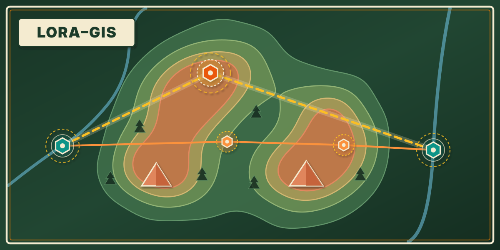

# lora-gis

[](https://github.com/nilgrad/lora-gis/actions/workflows/tests.yml)



A **PyQGIS** Line-of-Sight (LOS), **LoRa / MeshCore RF repeater pathfinder**, and **city rooftop viewshed analyzer** with automated map rendering and Markdown RF reporting. Designed for both mountainous terrain routing and flat/urban building coverage planning.

## Key Features

- **1-Hop & 2-Hop Repeater Discovery**: Scans coarse-to-fine terrain grids (500 m down to 150 m) to find single-relay and two-relay paths, plus explicit candidate site evaluation.
- **City Rooftop Ranking & Viewshed Coverage**: Evaluates buildings, water towers, silos, and DSM peaks across a city radius, ranking sites by covered area and recommending 2-site and 3-site combinations.
- **Urban Buildings & LiDAR DSMs**: Models building clutter and tree canopy using OpenStreetMap footprints, optional Overture Maps heights, NRCan 1 m Canadian LiDAR DSMs, local GeoTIFFs, or optional USGS 3DEP LiDAR streaming.
- **LoRa RF Propagation Modeling**: Computes 1st Fresnel Zone ($F_1$) clearance at 915, 868, or 433 MHz, 4/3 effective Earth curvature, terrain/surface clearance, and Free-Space Path Loss (FSPL).
- **Multi-Source Elevation & Auto-UTM**: Auto-detects the local UTM zone and streams elevation data from USGS 3DEP, NRCan CanElevation (Canada HRDEM and MRDEM-30), state GIS servers, custom ArcGIS ImageServers, or local GeoTIFFs.
- **Automated Cartography & Reports**: Exports 1920x1080 topographic, street, or satellite maps, cross-sectional terrain/LOS path and candidate profiles, viewshed coverage heatmaps, and Markdown RF reports.

---

## Quick Start

### Install via Conda / Mamba (macOS, Windows, Linux)

```bash
conda create -n lora-gis -c conda-forge python=3.11 qgis numpy pillow
conda activate lora-gis
pip install --no-build-isolation -e .
```

See [docs/installation.md](docs/installation.md) for native Linux, macOS, Windows (OSGeo4W) instructions, and optional `overture` / `lidar` extras.

### Run Your First Analysis

```bash
# 1. Simple point-to-point repeater discovery across terrain (US or Canada)
python3 -m lora_gis --route "Beacon, NY" "New Paltz, NY"
python3 -m lora_gis --route "Banff, AB" "Canmore, AB"

# 2. City rooftop viewshed ranking across a 3 km radius
python3 -m lora_gis --city "Salina, KS" --radius 3km --top 10 --rx-height 6ft
python3 -m lora_gis --city "Ottawa, ON" --dem canada-hrdem-dsm --radius 2km --top 10
```

---

## Documentation

| Guide | What It Covers |
| :--- | :--- |
| **[Installation & Setup](docs/installation.md)** | Conda/Mamba, native Linux/macOS/Windows packages, optional Overture/PDAL extras, and running tests. |
| **[Repeater Discovery](docs/repeater-discovery.md)** | Simple `--route` pathfinding, `--links` mesh topologies, JSON configs, `--candidates` relay evaluation, and interpreting RF metrics. |
| **[City & DSM Analysis](docs/city-and-dsm-analysis.md)** | Urban `--city` rooftop ranking, viewshed heatmaps, OSM/Overture/hybrid building overlays, local LiDAR DSM GeoTIFFs, and USGS 3DEP LiDAR EPT streaming. |
| **[CLI & Config Reference](docs/cli-reference.md)** | Complete categorized CLI option tables (`lora-gis --help`) and JSON configuration schema. |
| **[Python Library Usage](docs/python-api.md)** | Programmatic configs, headless `run_analysis()` calls, and lower-level DEM, RF, building, viewshed, and LiDAR APIs. |

---

## Sample Outputs

### Mountain Terrain Routing (`Roscoe <-> Livingston Manor <-> Liberty, NY`)

```bash
python3 -m lora_gis --state NY --dem ny-gis --route "Roscoe" "Livingston Manor" "Liberty" --hops 2 --candidates "shandelee-ridge=41.8804,-74.8890" "ferndale-ridge=41.7665,-74.6997" "willowemoc-ridge=41.9056,-74.6774"
```

- **Report**: [`examples/roscoe-livingston-manor-liberty/report.md`](examples/roscoe-livingston-manor-liberty/report.md)
- Finds 2-hop and hybrid repeater paths across two terrain-blocked Catskills legs (`7.95 km` and `12.93 km`, up to `70%` worst-case $F_1$), with cross-sectional blockage profiles for three candidate ridge sites.

### City Rooftop Viewshed & Building Clutter (`Salina, KS`)

```bash
python3 -m lora_gis --city "Salina, KS" --radius 2.5km --top 8 --rx-height 6ft --mast-height 10ft
```

- **Report**: [`examples/salina-ks-city-viewshed/report.md`](examples/salina-ks-city-viewshed/report.md)
- Rasterizes `12,281` OSM buildings onto USGS 3DEP terrain to rank tall structures for street-level (`6 ft`) coverage, reaching `34.4%` LOS (`10.1%` $F_1$) from `#1 Water Tower` and `43.3%` LOS (`22.7%` $F_1$) with a greedy 3-site combo.

### Canadian Rockies Routing (`Banff, AB <-> Canmore, AB`)

```bash
python3 -m lora_gis --route "Banff, AB" "Canmore, AB"
```

- **Report**: [`examples/banff-canmore-ab/report.md`](examples/banff-canmore-ab/report.md)
- Resolves places and Rockies summits via NRCan CGNDB, streams CanElevation HRDEM/MRDEM-30 terrain (`1,304 m` to `2,996 m`), and routes around Mount Rundle (`17.81 km`) with a 2-hop ridge solution (`128%` worst-case $F_1$).

---

## Acknowledgments

Special thanks to [@tectosage](https://github.com/tectosage) for contributions to the original implementation and code review.

---

## License

Released under the [MIT License](LICENSE).
