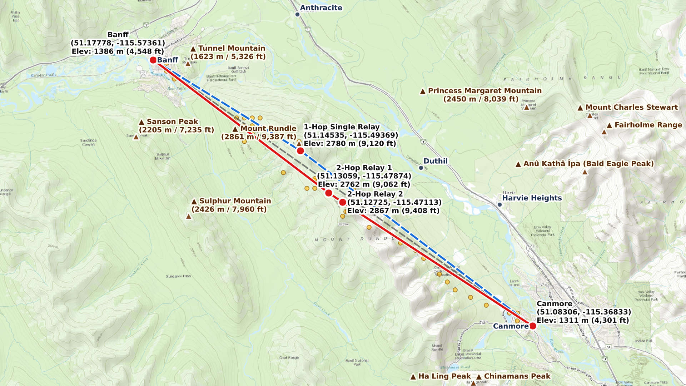

# LoRa-GIS 915 MHz LoRa (MeshCore) Relay Report — Banff ↔ Canmore (2026-11-24_09-36-40)

## 1. RF Link & Topology Overview

| Parameter | Value |
| :--- | :--- |
| **Operating Frequency** | `915.0 MHz` (LoRa / MeshCore, $\lambda = 32.8\text{ cm}$) |
| **Target Fresnel Clearance** | `>= 60%` of 1st Fresnel Zone ($F_1$), $K = 4/3$ Earth Curvature |
| **Surface Model** | Bare-earth DEM (bilinear interpolation) |
| **Intermediate Relay Height** | `18.3 m` (`60.0 ft`) AGL |
| **Banff** | `51.177778, -115.573611` — Ground Elev `1386.4 m` (`4,548 ft`), Mount `10.00 m` (`32.8 ft`) AGL |
| **Canmore** | `51.083056, -115.368333` — Ground Elev `1311.0 m` (`4,301 ft`), Mount `10.00 m` (`32.8 ft`) AGL |
| **Direct Link (Banff ↔ Canmore, `17.81 km`)** | BLOCKED BY TERRAIN (-1427.0 m / -4682 ft deficit) |
| **Viable 1-Hop Sites (Banff ↔ Canmore)** | `6` (`Banff` at `33 ft`, `Canmore` at `33 ft`) |
| **Viable 2-Hop Pairs (Banff ↔ Canmore)** | `39` |

## 2. Banff ↔ Canmore Link Analysis (`17.81 km` Direct)

- **Direct Distance**: `17.81 km` (`11.07 mi`)
- **Direct Line-of-Sight (`33 ft` at Banff → `33 ft` at Canmore)**: **BLOCKED BY TERRAIN** — Minimum terrain clearance is `-1427.0 m` (`-4682 ft`), Min $F_1$ ratio `-3770%`.

### Optimal 2-Hop Repeater Solution (Banff ↔ Canmore, Solid Red Path)

| Node | Latitude, Longitude (WGS84) | UTM Zone 11N (E, N) | Ground Elevation | Mount Height (AGL) | Total Tip Elevation (ASL) |
| :--- | :--- | :--- | :--- | :--- | :--- |
| **Banff** | `51.177778, -115.573611` | `E 599704.0, N 5670561.8` | `1386.4 m` (`4,548 ft`) | `10.00 m` (`33 ft`) | `1396.4 m` (`4,581 ft`) |
| **2-Hop Relay 1** | `51.130589, -115.478735` | `E 606444.0, N 5665447.3` | `2762.0 m` (`9,062 ft`) | `18.3 m` (`60 ft`) | `2780.3 m` (`9,122 ft`) |
| **2-Hop Relay 2** | `51.127252, -115.471127` | `E 606984.0, N 5665087.3` | `2867.5 m` (`9,408 ft`) | `18.3 m` (`60 ft`) | `2885.8 m` (`9,468 ft`) |
| **Canmore** | `51.083056, -115.368333` | `E 614285.6, N 5660327.3` | `1311.0 m` (`4,301 ft`) | `10.00 m` (`33 ft`) | `1321.0 m` (`4,334 ft`) |

| Hop Segment | Distance | Min Terrain Clearance | Min 1st Fresnel ($F_1$) Clearance | 915 MHz Free-Space Path Loss (FSPL) |
| :--- | :--- | :--- | :--- | :--- |
| **Hop 1: Banff → 2-Hop Relay 1** | `8.46 km` (`5.26 mi`) | `13.9 m` (`46 ft`) | **`128%`** | `110.2 dB` |
| **Hop 2: 2-Hop Relay 1 → 2-Hop Relay 2** | `0.65 km` (`0.40 mi`) | `16.1 m` (`53 ft`) | **`332%`** | `87.9 dB` |
| **Hop 3: 2-Hop Relay 2 → Canmore** | `8.72 km` (`5.42 mi`) | `13.1 m` (`43 ft`) | **`334%`** | `110.5 dB` |
| **Total 2-Hop Link** | **`17.83 km`** (`11.08 mi`, `+0.1%`) | `13.1 m` worst-case | **`128%`** worst-case | Max hop: `110.5 dB` |

### Optimal 1-Hop Single-Repeater Solution (Banff ↔ Canmore, Dashed Blue Path)

| Node | Latitude, Longitude (WGS84) | UTM Zone 11N (E, N) | Ground Elevation | Mount Height (AGL) | Total Tip Elevation (ASL) |
| :--- | :--- | :--- | :--- | :--- | :--- |
| **Banff** | `51.177778, -115.573611` | `E 599704.0, N 5670561.8` | `1386.4 m` (`4,548 ft`) | `10.00 m` (`33 ft`) | `1396.4 m` (`4,581 ft`) |
| **1-Hop Relay (Banff ↔ Canmore)** | `51.145351, -115.493691` | `E 605364.0, N 5667067.3` | `2779.7 m` (`9,120 ft`) | `18.3 m` (`60 ft`) | `2798.0 m` (`9,180 ft`) |
| **Canmore** | `51.083056, -115.368333` | `E 614285.6, N 5660327.3` | `1311.0 m` (`4,301 ft`) | `10.00 m` (`33 ft`) | `1321.0 m` (`4,334 ft`) |

| Hop Segment | Distance | Min Terrain Clearance | Min 1st Fresnel ($F_1$) Clearance | 915 MHz Free-Space Path Loss (FSPL) |
| :--- | :--- | :--- | :--- | :--- |
| **Leg 1: Banff (`33 ft`) → Relay** | `6.65 km` (`4.13 mi`) | `15.1 m` (`49 ft`) | **`154%`** | `108.1 dB` |
| **Leg 2: Relay → Canmore (`33 ft`)** | `11.18 km` (`6.95 mi`) | `-67.0 m` (`-220 ft`) | **`-239%`** | `112.6 dB` |
| **Total 1-Hop Link (Banff ↔ Canmore)** | **`17.83 km`** (`11.08 mi`, `+0.1%`) | `-67.0 m` worst-case | **`-239%`** worst-case | Max leg: `112.6 dB` |

### Top Discovered 1-Hop Candidate Sites (Banff ↔ Canmore)

| Rank | Relay Coordinate (Lat, Lon) | Ground Elev | Leg 1 (Banff → R) $F_1$ (Clear) | Leg 2 (R → Canmore) $F_1$ (Clear) | Worst-Case $F_1$ | Total Path Length |
| :--- | :--- | :--- | :--- | :--- | :--- | :--- |
| `#1` | `51.145351, -115.493691` | `2779.7 m` (`9,120 ft`) | `154%` (`22.7 m`) | `122%` (`8.2 m`) | **`122%`** | `17.83 km` (`11.08 mi`) |
| `#2` | `51.123982, -115.468663` | `2956.7 m` (`9,701 ft`) | `292%` (`25.5 m`) | `413%` (`24.2 m`) | **`292%`** | `17.84 km` (`11.09 mi`) |
| `#3` | `51.123994, -115.469520` | `2930.2 m` (`9,613 ft`) | `313%` (`29.4 m`) | `406%` (`23.9 m`) | **`313%`** | `17.85 km` (`11.09 mi`) |
| `#4` | `51.146969, -115.493638` | `2853.8 m` (`9,363 ft`) | `252%` (`18.4 m`) | `275%` (`20.5 m`) | **`252%`** | `17.85 km` (`11.09 mi`) |
| `#5` | `51.148598, -115.494443` | `2884.1 m` (`9,462 ft`) | `281%` (`14.5 m`) | `197%` (`20.7 m`) | **`197%`** | `17.87 km` (`11.10 mi`) |
| `#6` | `51.122398, -115.471288` | `2849.2 m` (`9,348 ft`) | `371%` (`25.9 m`) | `1%` (`0.3 m`) | **`1%`** | `17.88 km` (`11.11 mi`) |

### Top 10 Ranked 2-Relay Solutions (Banff ↔ Canmore)

| Rank | Relay 1 (Lat, Lon) | Relay 1 Elev | Relay 2 (Lat, Lon) | Relay 2 Elev | Worst-Case $F_1$ Clear | Min Clear (m) | Total Path Length |
| :--- | :--- | :--- | :--- | :--- | :--- | :--- | :--- |
| `#1` | `51.130589, -115.478735` | `2762 m` (`9,062 ft`) | `51.127252, -115.471127` | `2867 m` (`9,408 ft`) | **`136%`** | `16.1 m` | `17.83 km` (`11.08 mi`) |
| `#2` | `51.176534, -115.570788` | `1386 m` (`4,549 ft`) | `51.123994, -115.469520` | `2930 m` (`9,613 ft`) | **`224%`** | `10.1 m` | `17.85 km` (`11.09 mi`) |
| `#3` | `51.173785, -115.566581` | `1390 m` (`4,561 ft`) | `51.123994, -115.469520` | `2930 m` (`9,613 ft`) | **`154%`** | `10.1 m` | `17.85 km` (`11.09 mi`) |
| `#4` | `51.123994, -115.469520` | `2930 m` (`9,613 ft`) | `51.084909, -115.372290` | `1335 m` (`4,380 ft`) | **`243%`** | `10.1 m` | `17.85 km` (`11.09 mi`) |
| `#5` | `51.123994, -115.469520` | `2930 m` (`9,613 ft`) | `51.118431, -115.456844` | `2588 m` (`8,490 ft`) | **`255%`** | `12.1 m` | `17.85 km` (`11.09 mi`) |
| `#6` | `51.151623, -115.520082` | `2145 m` (`7,037 ft`) | `51.123994, -115.469520` | `2930 m` (`9,613 ft`) | **`100%`** | `10.5 m` | `17.85 km` (`11.09 mi`) |
| `#7` | `51.171036, -115.562375` | `1414 m` (`4,638 ft`) | `51.123994, -115.469520` | `2930 m` (`9,613 ft`) | **`127%`** | `10.3 m` | `17.85 km` (`11.09 mi`) |
| `#8` | `51.154374, -115.524284` | `2106 m` (`6,910 ft`) | `51.123994, -115.469520` | `2930 m` (`9,613 ft`) | **`232%`** | `10.6 m` | `17.85 km` (`11.09 mi`) |
| `#9` | `51.123994, -115.469520` | `2930 m` (`9,613 ft`) | `51.087665, -115.376477` | `1374 m` (`4,507 ft`) | **`201%`** | `9.5 m` | `17.86 km` (`11.10 mi`) |
| `#10` | `51.157125, -115.528487` | `2054 m` (`6,738 ft`) | `51.123994, -115.469520` | `2930 m` (`9,613 ft`) | **`67%`** | `8.1 m` | `17.86 km` (`11.10 mi`) |

## 3. Grid Resolution Scan Summary

| Link | Grid Step (m) | Candidate Grid Points | Visible from Node 1 | Visible from Node 2 | Valid 1-Hop Sites | 2-Hop Pairs Evaluated | Valid 2-Hop Solutions |
| :--- | :--- | :--- | :--- | :--- | :--- | :--- | :--- |
| **Banff ↔ Canmore** | `500.0 m` | `850` | `120` | `91` | **`0`** | `1500` | **`0`** |
| **Banff ↔ Canmore** | `300.0 m` | `2296` | `338` | `224` | **`2`** | `1500` | **`37`** |
| **Banff ↔ Canmore** | `180.0 m` | `6324` | `910` | `630` | **`4`** | `1500` | **`2`** |

## 4. Surrounding Terrain Features (NRCan CGNDB GeoNames)

### Mountain Summits & Peaks
- **Anû Kathâ Îpa (Bald Eagle Peak)**: `51.13611, -115.33778`
- **Tunnel Mountain**: `1623 m` (`5,326 ft`) — `51.17639, -115.55472`
- **Mount Charles Stewart**: `51.15555, -115.33416`
- **Mount Rundle**: `2861 m` (`9,387 ft`) — `51.14789, -115.49441`
- **Sanson Peak**: `2205 m` (`7,235 ft`) — `51.15139, -115.58389`
- **Chinamans Peak**: `51.06389, -115.40139`
- **Princess Margaret Mountain**: `2450 m` (`8,039 ft`) — `51.15889, -115.36889`
- **Sulphur Mountain**: `2426 m` (`7,960 ft`) — `51.12361, -115.55583`
- **Fairholme Range**: `51.14972, -115.32666`
- **Ha Ling Peak**: `51.06389, -115.40139`

### Populated Places & Towns
- **Harvie Heights**: `51.12528, -115.38500`
- **Duthil**: `51.13861, -115.42778`
- **Anthracite**: `51.19250, -115.49389`
- **Canmore**: `51.08305, -115.36833`
- **Banff**: `51.17778, -115.57361`

