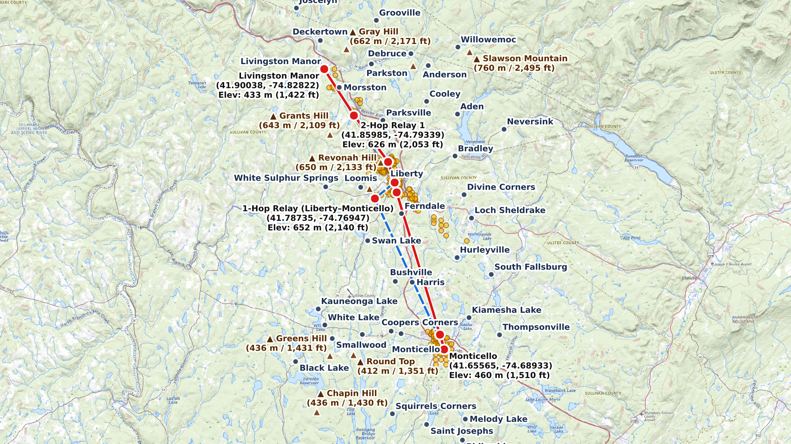

# LoRa-GIS 915 MHz LoRa (MeshCore) Relay Report — Livingston Manor ↔ Liberty ↔ Monticello (2026-11-15_20-39-15)

## 1. RF Link & Topology Overview

| Parameter | Value |
| :--- | :--- |
| **Operating Frequency** | `915.0 MHz` (LoRa / MeshCore, $\lambda = 32.8\text{ cm}$) |
| **Target Fresnel Clearance** | `>= 60%` of 1st Fresnel Zone ($F_1$), $K = 4/3$ Earth Curvature |
| **Intermediate Relay Height** | `18.3 m` (`60.0 ft`) AGL |
| **Livingston Manor** | `41.900375, -74.828218` — Ground Elev `433.3 m` (`1,422 ft`), Mount `10.00 m` (`32.8 ft`) AGL |
| **Liberty (Repeater Hub)** | `41.801209, -74.746552` — Ground Elev `457.7 m` (`1,502 ft`), Mount `9.14 m` (`30.0 ft`) AGL |
| **Monticello** | `41.655655, -74.689330` — Ground Elev `460.1 m` (`1,510 ft`), Mount `10.00 m` (`32.8 ft`) AGL |
| **Direct Link (Livingston Manor ↔ Liberty, `12.93 km`)** | BLOCKED BY TERRAIN (-188.7 m / -619 ft deficit) |
| **Viable 1-Hop Sites (Livingston Manor ↔ Liberty)** | `0` (`Livingston Manor` at `33 ft`, `Liberty` at `30 ft`) |
| **Viable 2-Hop Pairs (Livingston Manor ↔ Liberty)** | `58` |
| **Direct Link (Liberty ↔ Monticello, `16.85 km`)** | BLOCKED BY TERRAIN (-32.7 m / -107 ft deficit) |
| **Viable 1-Hop Sites (Liberty ↔ Monticello)** | `68` (`Liberty` at `30 ft`, `Monticello` at `33 ft`) |
| **Viable 2-Hop Pairs (Liberty ↔ Monticello)** | `1331` |

## 2. Livingston Manor ↔ Liberty Link Analysis (`12.93 km` Direct)

- **Direct Distance**: `12.93 km` (`8.03 mi`)
- **Direct Line-of-Sight (`33 ft` at Livingston Manor → `30 ft` at Liberty)**: **BLOCKED BY TERRAIN** — Minimum terrain clearance is `-188.7 m` (`-619 ft`), Min $F_1$ ratio `-835%`.

### Optimal 2-Hop Repeater Solution (Livingston Manor ↔ Liberty, Solid Red Path)

| Node | Latitude, Longitude (WGS84) | UTM Zone 18N (E, N) | Ground Elevation | Mount Height (AGL) | Total Tip Elevation (ASL) |
| :--- | :--- | :--- | :--- | :--- | :--- |
| **Livingston Manor** | `41.900375, -74.828218` | `E 514248.7, N 4638729.4` | `433.3 m` (`1,422 ft`) | `10.00 m` (`33 ft`) | `443.3 m` (`1,454 ft`) |
| **2-Hop Relay 1** | `41.859847, -74.793387` | `E 517148.7, N 4634236.1` | `625.6 m` (`2,053 ft`) | `18.3 m` (`60 ft`) | `643.9 m` (`2,113 ft`) |
| **2-Hop Relay 2** | `41.819238, -74.753783` | `E 520448.7, N 4629736.1` | `637.1 m` (`2,090 ft`) | `18.3 m` (`60 ft`) | `655.4 m` (`2,150 ft`) |
| **Liberty** | `41.801209, -74.746552` | `E 521055.2, N 4627736.1` | `457.7 m` (`1,502 ft`) | `9.14 m` (`30 ft`) | `466.9 m` (`1,532 ft`) |

| Hop Segment | Distance | Min Terrain Clearance | Min 1st Fresnel ($F_1$) Clearance | 915 MHz Free-Space Path Loss (FSPL) |
| :--- | :--- | :--- | :--- | :--- |
| **Hop 1: Livingston Manor → Relay 1** | `5.35 km` (`3.32 mi`) | `13.5 m` (`44 ft`) | **`79%`** | `106.2 dB` |
| **Hop 2: Relay 1 → Relay 2** | `5.58 km` (`3.47 mi`) | `11.5 m` (`38 ft`) | **`69%`** | `106.6 dB` |
| **Hop 3: Relay 2 → Liberty** | `2.09 km` (`1.30 mi`) | `10.7 m` (`35 ft`) | **`290%`** | `98.1 dB` |
| **Total 2-Hop Link** | **`13.02 km`** (`8.09 mi`, `+0.7%`) | `10.7 m` worst-case | **`69%`** worst-case | Max hop: `106.6 dB` |

### Livingston Manor ↔ Liberty 1-Hop Sensitivity to Liberty Repeater Height (with `60 ft` Intermediate Relay)

| Liberty Repeater Height | Visible from Livingston Manor | Visible from Liberty | Viable 1-Hop Sites | Fresnel-Clear (`>= 60% F1`) | Best 1-Hop Relay (Lat, Lon) | Worst-Case $F_1$ (Min Clear) |
| :--- | :--- | :--- | :--- | :--- | :--- | :--- |
| **30 ft (9.14 m) at Liberty** | `435` | `236` | `0` | `0` | *None* | — |
| **33 ft (10.0 m) at Liberty** | `435` | `245` | `0` | `0` | *None* | — |
| **45 ft (13.7 m) at Liberty** | `435` | `267` | `0` | `0` | *None* | — |
| **60 ft (18.3 m) at Liberty** | `435` | `297` | `0` | `0` | *None* | — |
| **63 ft (19.14 m = 10m + 30ft) at Liberty** | `435` | `306` | `0` | `0` | *None* | — |
| **90 ft (27.4 m) at Liberty** | `435` | `377` | `0` | `0` | *None* | — |

### Top 10 Ranked 2-Relay Solutions (Livingston Manor ↔ Liberty)

| Rank | Relay 1 (Lat, Lon) | Relay 1 Elev | Relay 2 (Lat, Lon) | Relay 2 Elev | Worst-Case $F_1$ Clear | Min Clear (m) | Total Path Length |
| :--- | :--- | :--- | :--- | :--- | :--- | :--- | :--- |
| `#1` | `41.859847, -74.793387` | `626 m` (`2,053 ft`) | `41.819238, -74.753783` | `637 m` (`2,090 ft`) | **`69%`** | `10.7 m` | `13.02 km` (`8.09 mi`) |
| `#2` | `41.859847, -74.793387` | `626 m` (`2,053 ft`) | `41.813857, -74.764639` | `637 m` (`2,089 ft`) | **`79%`** | `9.4 m` | `13.04 km` (`8.10 mi`) |
| `#3` | `41.884214, -74.822235` | `607 m` (`1,992 ft`) | `41.819238, -74.753783` | `637 m` (`2,090 ft`) | **`60%`** | `10.7 m` | `13.13 km` (`8.16 mi`) |
| `#4` | `41.859847, -74.793387` | `626 m` (`2,053 ft`) | `41.821933, -74.750160` | `643 m` (`2,108 ft`) | **`61%`** | `10.9 m` | `13.20 km` (`8.20 mi`) |
| `#5` | `41.900417, -74.816162` | `555 m` (`1,821 ft`) | `41.814753, -74.762228` | `641 m` (`2,103 ft`) | **`59%`** | `7.6 m` | `13.50 km` (`8.39 mi`) |
| `#6` | `41.859847, -74.793387` | `626 m` (`2,053 ft`) | `41.813842, -74.757416` | `644 m` (`2,112 ft`) | **`56%`** | `8.5 m` | `12.93 km` (`8.04 mi`) |
| `#7` | `41.860387, -74.792662` | `616 m` (`2,020 ft`) | `41.814929, -74.760301` | `642 m` (`2,105 ft`) | **`56%`** | `3.9 m` | `12.95 km` (`8.05 mi`) |
| `#8` | `41.860387, -74.792662` | `616 m` (`2,020 ft`) | `41.814924, -74.758134` | `645 m` (`2,117 ft`) | **`51%`** | `3.5 m` | `12.94 km` (`8.04 mi`) |
| `#9` | `41.884214, -74.822235` | `607 m` (`1,992 ft`) | `41.813842, -74.757416` | `644 m` (`2,112 ft`) | **`47%`** | `8.2 m` | `13.02 km` (`8.09 mi`) |
| `#10` | `41.884749, -74.818618` | `573 m` (`1,878 ft`) | `41.814924, -74.758134` | `645 m` (`2,117 ft`) | **`44%`** | `3.5 m` | `12.95 km` (`8.04 mi`) |

## 3. Liberty ↔ Monticello Link Analysis (`16.85 km` Direct)

- **Direct Distance**: `16.85 km` (`10.47 mi`)
- **Direct Line-of-Sight (`30 ft` at Liberty → `33 ft` at Monticello)**: **BLOCKED BY TERRAIN** — Minimum terrain clearance is `-32.7 m` (`-107 ft`), Min $F_1$ ratio `-155%`.

### Optimal 2-Hop Repeater Solution (Liberty ↔ Monticello, Solid Red Path)

| Node | Latitude, Longitude (WGS84) | UTM Zone 18N (E, N) | Ground Elevation | Mount Height (AGL) | Total Tip Elevation (ASL) |
| :--- | :--- | :--- | :--- | :--- | :--- |
| **Liberty** | `41.801209, -74.746552` | `E 521055.2, N 4627736.1` | `457.7 m` (`1,502 ft`) | `9.14 m` (`30 ft`) | `466.9 m` (`1,532 ft`) |
| **2-Hop Relay 1** | `41.792698, -74.744178` | `E 521255.2, N 4626791.7` | `503.0 m` (`1,650 ft`) | `18.3 m` (`60 ft`) | `521.3 m` (`1,710 ft`) |
| **2-Hop Relay 2** | `41.668278, -74.694219` | `E 525455.2, N 4612991.7` | `475.1 m` (`1,559 ft`) | `18.3 m` (`60 ft`) | `493.4 m` (`1,619 ft`) |
| **Monticello** | `41.655655, -74.689330` | `E 525867.2, N 4611591.7` | `460.1 m` (`1,510 ft`) | `10.00 m` (`33 ft`) | `470.1 m` (`1,542 ft`) |

| Hop Segment | Distance | Min Terrain Clearance | Min 1st Fresnel ($F_1$) Clearance | 915 MHz Free-Space Path Loss (FSPL) |
| :--- | :--- | :--- | :--- | :--- |
| **Hop 1: Liberty → Relay 1** | `0.97 km` (`0.60 mi`) | `10.1 m` (`33 ft`) | **`273%`** | `91.4 dB` |
| **Hop 2: Relay 1 → Relay 2** | `14.42 km` (`8.96 mi`) | `23.4 m` (`77 ft`) | **`101%`** | `114.9 dB` |
| **Hop 3: Relay 2 → Monticello** | `1.46 km` (`0.91 mi`) | `6.6 m` (`22 ft`) | **`67%`** | `95.0 dB` |
| **Total 2-Hop Link** | **`16.85 km`** (`10.47 mi`, `+0.0%`) | `6.6 m` worst-case | **`67%`** worst-case | Max hop: `114.9 dB` |

### Optimal 1-Hop Single-Repeater Solution (Liberty ↔ Monticello, Dashed Blue Path)

| Node | Latitude, Longitude (WGS84) | UTM Zone 18N (E, N) | Ground Elevation | Mount Height (AGL) | Total Tip Elevation (ASL) |
| :--- | :--- | :--- | :--- | :--- | :--- |
| **Liberty** | `41.801209, -74.746552` | `E 521055.2, N 4627736.1` | `457.7 m` (`1,502 ft`) | `9.14 m` (`30 ft`) | `466.9 m` (`1,532 ft`) |
| **1-Hop Relay (Liberty ↔ Monticello)** | `41.787347, -74.769472` | `E 519155.2, N 4626191.7` | `652.2 m` (`2,140 ft`) | `18.3 m` (`60 ft`) | `670.5 m` (`2,200 ft`) |
| **Monticello** | `41.655655, -74.689330` | `E 525867.2, N 4611591.7` | `460.1 m` (`1,510 ft`) | `10.00 m` (`33 ft`) | `470.1 m` (`1,542 ft`) |

| Hop Segment | Distance | Min Terrain Clearance | Min 1st Fresnel ($F_1$) Clearance | 915 MHz Free-Space Path Loss (FSPL) |
| :--- | :--- | :--- | :--- | :--- |
| **Leg 1: Liberty (`30 ft`) → Relay** | `2.45 km` (`1.52 mi`) | `9.4 m` (`31 ft`) | **`118%`** | `99.4 dB` |
| **Leg 2: Relay → Monticello (`33 ft`)** | `16.07 km` (`9.98 mi`) | `8.9 m` (`29 ft`) | **`43%`** | `115.8 dB` |
| **Total 1-Hop Link (Liberty ↔ Monticello)** | **`18.52 km`** (`11.51 mi`, `+9.9%`) | `8.9 m` worst-case | **`43%`** worst-case | Max leg: `115.8 dB` |

### Liberty ↔ Monticello 1-Hop Sensitivity to Liberty Repeater Height (with `60 ft` Intermediate Relay)

| Liberty Repeater Height | Visible from Liberty | Visible from Monticello | Viable 1-Hop Sites | Fresnel-Clear (`>= 60% F1`) | Best 1-Hop Relay (Lat, Lon) | Worst-Case $F_1$ (Min Clear) |
| :--- | :--- | :--- | :--- | :--- | :--- | :--- |
| **30 ft (9.14 m) at Liberty** | `393` | `505` | **`68`** | **`0`** | `41.787347, -74.769472` | **`43%`** (`8.9 m`) |
| **33 ft (10.0 m) at Liberty** | `406` | `505` | **`69`** | **`0`** | `41.787347, -74.769472` | **`43%`** (`8.9 m`) |
| **45 ft (13.7 m) at Liberty** | `472` | `505` | **`72`** | **`0`** | `41.787347, -74.769472` | **`43%`** (`8.9 m`) |
| **60 ft (18.3 m) at Liberty** | `618` | `505` | **`84`** | **`0`** | `41.787347, -74.769472` | **`43%`** (`8.9 m`) |
| **63 ft (19.14 m = 10m + 30ft) at Liberty** | `650` | `505` | **`89`** | **`0`** | `41.787347, -74.769472` | **`43%`** (`8.9 m`) |
| **90 ft (27.4 m) at Liberty** | `1086` | `505` | **`98`** | **`0`** | `41.787347, -74.769472` | **`43%`** (`8.9 m`) |

### Top Discovered 1-Hop Candidate Sites (Liberty ↔ Monticello)

| Rank | Relay Coordinate (Lat, Lon) | Ground Elev | Leg 1 (Liberty → R) $F_1$ (Clear) | Leg 2 (R → Monticello) $F_1$ (Clear) | Worst-Case $F_1$ | Total Path Length |
| :--- | :--- | :--- | :--- | :--- | :--- | :--- |
| `#1` | `41.787347, -74.769472` | `652.2 m` (`2,140 ft`) | `118%` (`9.4 m`) | `43%` (`8.9 m`) | **`43%`** | `18.52 km` (`11.51 mi`) |
| `#2` | `41.819742, -74.754907` | `642.3 m` (`2,107 ft`) | `174%` (`10.6 m`) | `34%` (`6.7 m`) | **`34%`** | `21.19 km` (`13.17 mi`) |
| `#3` | `41.814883, -74.757093` | `644.9 m` (`2,116 ft`) | `47%` (`3.2 m`) | `31%` (`6.3 m`) | **`31%`** | `20.31 km` (`12.62 mi`) |
| `#4` | `41.821359, -74.752734` | `639.1 m` (`2,097 ft`) | `265%` (`10.7 m`) | `30%` (`5.3 m`) | **`30%`** | `21.43 km` (`13.32 mi`) |
| `#5` | `41.818121, -74.754913` | `631.2 m` (`2,071 ft`) | `179%` (`10.6 m`) | `30%` (`6.2 m`) | **`30%`** | `20.85 km` (`12.95 mi`) |
| `#6` | `41.819737, -74.752740` | `616.5 m` (`2,023 ft`) | `220%` (`10.5 m`) | `30%` (`5.2 m`) | **`30%`** | `21.09 km` (`13.10 mi`) |
| `#7` | `41.784645, -74.769482` | `618.8 m` (`2,030 ft`) | `76%` (`5.9 m`) | `29%` (`5.9 m`) | **`29%`** | `18.44 km` (`11.46 mi`) |
| `#8` | `41.817040, -74.754918` | `628.8 m` (`2,063 ft`) | `279%` (`10.6 m`) | `29%` (`6.0 m`) | **`29%`** | `20.62 km` (`12.81 mi`) |
| `#9` | `41.816500, -74.754920` | `628.8 m` (`2,063 ft`) | `298%` (`10.7 m`) | `29%` (`6.0 m`) | **`29%`** | `20.51 km` (`12.74 mi`) |
| `#10` | `41.818112, -74.750579` | `599.7 m` (`1,967 ft`) | `276%` (`10.7 m`) | `29%` (`5.0 m`) | **`29%`** | `20.65 km` (`12.83 mi`) |

### Top 10 Ranked 2-Relay Solutions (Liberty ↔ Monticello)

| Rank | Relay 1 (Lat, Lon) | Relay 1 Elev | Relay 2 (Lat, Lon) | Relay 2 Elev | Worst-Case $F_1$ Clear | Min Clear (m) | Total Path Length |
| :--- | :--- | :--- | :--- | :--- | :--- | :--- | :--- |
| `#1` | `41.792698, -74.744178` | `503 m` (`1,650 ft`) | `41.668278, -74.694219` | `475 m` (`1,559 ft`) | **`67%`** | `6.6 m` | `16.85 km` (`10.47 mi`) |
| `#2` | `41.792157, -74.744180` | `500 m` (`1,641 ft`) | `41.663951, -74.692798` | `471 m` (`1,547 ft`) | **`89%`** | `9.1 m` | `16.85 km` (`10.47 mi`) |
| `#3` | `41.792157, -74.744180` | `500 m` (`1,641 ft`) | `41.665572, -74.692790` | `481 m` (`1,579 ft`) | **`95%`** | `9.5 m` | `16.85 km` (`10.47 mi`) |
| `#4` | `41.792698, -74.744178` | `503 m` (`1,650 ft`) | `41.665576, -74.694231` | `468 m` (`1,536 ft`) | **`86%`** | `5.3 m` | `16.85 km` (`10.47 mi`) |
| `#5` | `41.792157, -74.744180` | `500 m` (`1,641 ft`) | `41.667199, -74.694945` | `479 m` (`1,573 ft`) | **`93%`** | `9.1 m` | `16.85 km` (`10.47 mi`) |
| `#6` | `41.793774, -74.742007` | `495 m` (`1,625 ft`) | `41.665572, -74.692790` | `481 m` (`1,579 ft`) | **`66%`** | `9.2 m` | `16.86 km` (`10.47 mi`) |
| `#7` | `41.793774, -74.742007` | `495 m` (`1,625 ft`) | `41.663951, -74.692798` | `471 m` (`1,547 ft`) | **`63%`** | `8.5 m` | `16.86 km` (`10.47 mi`) |
| `#8` | `41.792157, -74.744180` | `500 m` (`1,641 ft`) | `41.665578, -74.694952` | `470 m` (`1,543 ft`) | **`97%`** | `6.9 m` | `16.86 km` (`10.48 mi`) |
| `#9` | `41.793774, -74.742007` | `495 m` (`1,625 ft`) | `41.667199, -74.694945` | `479 m` (`1,573 ft`) | **`65%`** | `9.1 m` | `16.86 km` (`10.48 mi`) |
| `#10` | `41.792157, -74.744180` | `500 m` (`1,641 ft`) | `41.663957, -74.694960` | `472 m` (`1,549 ft`) | **`104%`** | `9.3 m` | `16.87 km` (`10.48 mi`) |

## 4. Grid Resolution Scan Summary

| Link | Grid Step (m) | Candidate Grid Points | Visible from Node 1 | Visible from Node 2 | Valid 1-Hop Sites | 2-Hop Pairs Evaluated | Valid 2-Hop Solutions |
| :--- | :--- | :--- | :--- | :--- | :--- | :--- | :--- |
| **Livingston Manor ↔ Liberty** | `500.0 m` | `468` | `36` | `22` | **`0`** | `687` | **`11`** |
| **Livingston Manor ↔ Liberty** | `300.0 m` | `1320` | `110` | `62` | **`0`** | `1500` | **`28`** |
| **Livingston Manor ↔ Liberty** | `180.0 m` | `3577` | `308` | `164` | **`0`** | `1500` | **`19`** |
| **Liberty ↔ Monticello** | `500.0 m` | `860` | `37` | `48` | **`6`** | `1167` | **`471`** |
| **Liberty ↔ Monticello** | `300.0 m` | `2343` | `103` | `127` | **`19`** | `1500` | **`393`** |
| **Liberty ↔ Monticello** | `180.0 m` | `6490` | `272` | `353` | **`48`** | `1500` | **`468`** |

## 5. Surrounding Terrain Features (USGS GeoNames)

### Mountain Summits & Peaks
- **Grants Hill**: `643 m` (`2,109 ft`) — `41.84342, -74.82155`
- **Chapin Hill**: `436 m` (`1,430 ft`) — `41.60148, -74.83739`
- **Greens Hill**: `436 m` (`1,431 ft`) — `41.65034, -74.82198`
- **Round Top**: `412 m` (`1,351 ft`) — `41.65092, -74.79489`
- **Gray Hill**: `662 m` (`2,171 ft`) — `41.91787, -74.80183`
- **Revonah Hill**: `650 m` (`2,133 ft`) — `41.81875, -74.76236`
- **Chuck Hill**: `616 m` (`2,022 ft`) — `41.79575, -74.77553`
- **Walnut Mountain**: `652 m` (`2,140 ft`) — `41.78750, -74.76933`
- **Slawson Mountain**: `760 m` (`2,495 ft`) — `41.91481, -74.65849`
- **Bald Mountain**: `702 m` (`2,303 ft`) — `41.90288, -74.72437`

### Populated Places & Towns
- **Harris**: `41.71426, -74.72627`
- **Kauneonga Lake**: `41.69120, -74.83572`
- **Coopers Corners**: `41.67148, -74.75100`
- **Bushville**: `41.71509, -74.74600`
- **Morsston**: `41.88426, -74.81044`
- **Mongaup Valley**: `41.66870, -74.78461`
- **Anderson**: `41.90315, -74.70683`
- **Black Lake**: `41.64537, -74.86183`
- **Livingston Manor**: `41.90037, -74.82822`
- **Thompsonville**: `41.66815, -74.62516`
- **Kiamesha Lake**: `41.68315, -74.66072`
- **Squirrels Corners**: `41.59953, -74.74961`
- **Grooville**: `41.94259, -74.76738`
- **Divine Corners**: `41.79037, -74.66572`
- **Loomis**: `41.79731, -74.78572`
- **Philwold**: `41.57648, -74.66877`
- **White Sulphur Springs**: `41.79759, -74.82683`
- **Melody Lake**: `41.59481, -74.66516`
- **White Lake**: `41.67703, -74.82794`
- **Loch Sheldrake**: `41.77009, -74.65710`
- **Parksville**: `41.85537, -74.75960`
- **Smallwood**: `41.66537, -74.81933`
- **Willowemoc**: `41.91898, -74.67238`
- **Deckertown**: `41.92509, -74.83266`
- **Hurleyville**: `41.73565, -74.67433`
- **Neversink**: `41.84731, -74.61905`
- **Bradley**: `41.82398, -74.67627`
- **South Fallsburg**: `41.72065, -74.63433`
- **Joscelyn**: `41.95370, -74.86044`
- **Ferndale**: `41.77398, -74.73849`
- **Cooley**: `41.87176, -74.70905`
- **Aden**: `41.86065, -74.67321`
- **Saint Josephs**: `41.59009, -74.71016`
- **Debruce**: `41.91370, -74.72710`
- **Liberty**: `41.80120, -74.74655`
- **Swan Lake**: `41.75064, -74.77794`
- **Maplewood**: `41.66953, -74.73961`
- **Parkston**: `41.90453, -74.77294`
- **Monticello**: `41.65565, -74.68933`

