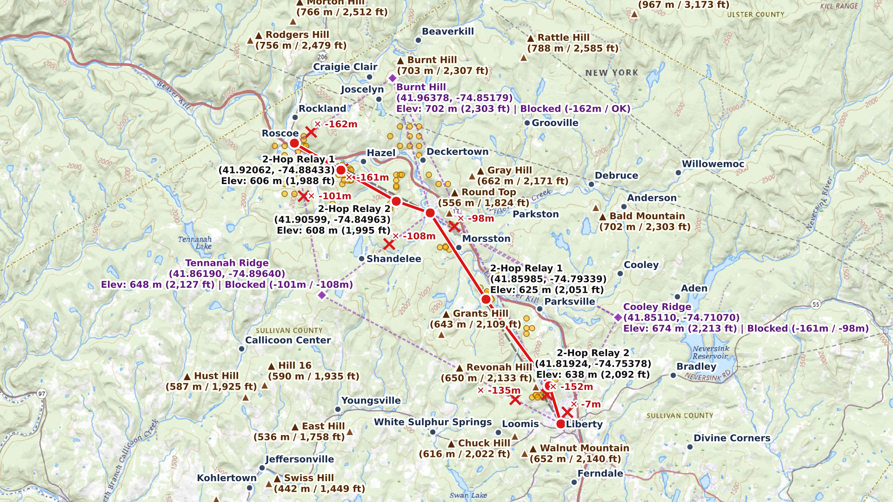

# LoRa-GIS 915 MHz LoRa (MeshCore) Relay Report — Roscoe ↔ Livingston Manor ↔ Liberty (2026-11-23_07-50-09)

## 1. RF Link & Topology Overview

| Parameter | Value |
| :--- | :--- |
| **Operating Frequency** | `915.0 MHz` (LoRa / MeshCore, $\lambda = 32.8\text{ cm}$) |
| **Target Fresnel Clearance** | `>= 60%` of 1st Fresnel Zone ($F_1$), $K = 4/3$ Earth Curvature |
| **Intermediate Relay Height** | `18.3 m` (`60.0 ft`) AGL |
| **Roscoe** | `41.933153, -74.913498` — Ground Elev `390.8 m` (`1,282 ft`), Mount `10.00 m` (`32.8 ft`) AGL |
| **Livingston Manor (Repeater Hub)** | `41.900375, -74.828218` — Ground Elev `433.1 m` (`1,421 ft`), Mount `9.14 m` (`30.0 ft`) AGL |
| **Liberty** | `41.801209, -74.746552` — Ground Elev `457.8 m` (`1,502 ft`), Mount `10.00 m` (`32.8 ft`) AGL |
| **Burnt Hill (Candidate Relay)** | `41.963780, -74.851790`, Ground Elev `702.0 m` (`2,303 ft`), Mount `18.30 m` (`60.0 ft`) AGL |
| **Tennanah Ridge (Candidate Relay)** | `41.861900, -74.896400`, Ground Elev `648.3 m` (`2,127 ft`), Mount `18.30 m` (`60.0 ft`) AGL |
| **Cooley Ridge (Candidate Relay)** | `41.851100, -74.710700`, Ground Elev `674.5 m` (`2,213 ft`), Mount `18.30 m` (`60.0 ft`) AGL |
| **Direct Link (Roscoe ↔ Livingston Manor, `7.95 km`)** | BLOCKED BY TERRAIN (-185.4 m / -608 ft deficit) |
| **Viable 1-Hop Sites (Roscoe ↔ Livingston Manor)** | `0` (`Roscoe` at `33 ft`, `Livingston Manor` at `30 ft`) |
| **Viable 2-Hop Pairs (Roscoe ↔ Livingston Manor)** | `245` |
| **Direct Link (Livingston Manor ↔ Liberty, `12.93 km`)** | BLOCKED BY TERRAIN (-188.4 m / -618 ft deficit) |
| **Viable 1-Hop Sites (Livingston Manor ↔ Liberty)** | `0` (`Livingston Manor` at `30 ft`, `Liberty` at `33 ft`) |
| **Viable 2-Hop Pairs (Livingston Manor ↔ Liberty)** | `84` |

## 2. Roscoe ↔ Livingston Manor Link Analysis (`7.95 km` Direct)

- **Direct Distance**: `7.95 km` (`4.94 mi`)
- **Direct Line-of-Sight (`33 ft` at Roscoe → `30 ft` at Livingston Manor)**: **BLOCKED BY TERRAIN** — Minimum terrain clearance is `-185.4 m` (`-608 ft`), Min $F_1$ ratio `-810%`.

### Optimal 2-Hop Repeater Solution (Roscoe ↔ Livingston Manor, Solid Red Path)

| Node | Latitude, Longitude (WGS84) | UTM Zone 18N (E, N) | Ground Elevation | Mount Height (AGL) | Total Tip Elevation (ASL) |
| :--- | :--- | :--- | :--- | :--- | :--- |
| **Roscoe** | `41.933153, -74.913498` | `E 507171.4, N 4642357.9` | `390.8 m` (`1,282 ft`) | `10.00 m` (`33 ft`) | `400.8 m` (`1,315 ft`) |
| **2-Hop Relay 1** | `41.920621, -74.884330` | `E 509591.4, N 4640969.4` | `605.8 m` (`1,988 ft`) | `18.3 m` (`60 ft`) | `624.1 m` (`2,048 ft`) |
| **2-Hop Relay 2** | `41.905989, -74.849633` | `E 512471.4, N 4639349.4` | `608.2 m` (`1,995 ft`) | `18.3 m` (`60 ft`) | `626.5 m` (`2,055 ft`) |
| **Livingston Manor** | `41.900375, -74.828218` | `E 514248.7, N 4638729.4` | `433.1 m` (`1,421 ft`) | `9.14 m` (`30 ft`) | `442.3 m` (`1,451 ft`) |

| Hop Segment | Distance | Min Terrain Clearance | Min 1st Fresnel ($F_1$) Clearance | 915 MHz Free-Space Path Loss (FSPL) |
| :--- | :--- | :--- | :--- | :--- |
| **Hop 1: Roscoe → 2-Hop Relay 1** | `2.79 km` (`1.73 mi`) | `12.9 m` (`42 ft`) | **`327%`** | `100.6 dB` |
| **Hop 2: 2-Hop Relay 1 → 2-Hop Relay 2** | `3.30 km` (`2.05 mi`) | `7.1 m` (`23 ft`) | **`68%`** | `102.1 dB` |
| **Hop 3: 2-Hop Relay 2 → Livingston Manor** | `1.88 km` (`1.17 mi`) | `10.1 m` (`33 ft`) | **`144%`** | `97.2 dB` |
| **Total 2-Hop Link** | **`7.98 km`** (`4.96 mi`, `+0.3%`) | `7.1 m` worst-case | **`68%`** worst-case | Max hop: `102.1 dB` |

### Explicit Candidate Relay Evaluation (Roscoe ↔ Livingston Manor)

| Candidate Site | Coordinates (Lat, Lon) | Ground Elev | Mount (AGL) | Leg 1 (Roscoe → C) | Leg 2 (C → Livingston Manor) | 1-Hop Verdict | Total Path |
| :--- | :--- | :--- | :--- | :--- | :--- | :--- | :--- |
| **Burnt Hill** | `41.963780, -74.851790` | `702.0 m` (`2,303 ft`) | `18.30 m` (`60 ft`) | BLOCKED (`-161.8 m`, `6.14 km`) | CLEAR: `156%` F1 (`9.6 m`, `7.31 km`, `108.9 dB`) | BLOCKED (`-161.8 m`) | `13.45 km` |
| **Tennanah Ridge** | `41.861900, -74.896400` | `648.3 m` (`2,127 ft`) | `18.30 m` (`60 ft`) | BLOCKED (`-101.2 m`, `8.04 km`) | BLOCKED (`-108.0 m`, `7.09 km`) | BLOCKED (`-108.0 m`) | `15.13 km` |
| **Cooley Ridge** | `41.851100, -74.710700` | `674.5 m` (`2,213 ft`) | `18.30 m` (`60 ft`) | BLOCKED (`-160.8 m`, `19.13 km`) | BLOCKED (`-98.3 m`, `11.18 km`) | BLOCKED (`-160.8 m`) | `30.31 km` |

### Explicit Candidate Sensitivity to Livingston Manor Repeater Height

| Livingston Manor Height | Burnt Hill | Tennanah Ridge | Cooley Ridge |
| :--- | :--- | :--- | :--- |
| **30 ft (9.14 m) at Livingston Manor** | Blocked (L1 blk, L2 OK; `-161.8 m`) | Blocked (L1 blk, L2 blk; `-108.0 m`) | Blocked (L1 blk, L2 blk; `-160.8 m`) |
| **33 ft (10.0 m) at Livingston Manor** | Blocked (L1 blk, L2 OK; `-161.8 m`) | Blocked (L1 blk, L2 blk; `-107.5 m`) | Blocked (L1 blk, L2 blk; `-160.8 m`) |
| **45 ft (13.7 m) at Livingston Manor** | Blocked (L1 blk, L2 OK; `-161.8 m`) | Blocked (L1 blk, L2 blk; `-105.1 m`) | Blocked (L1 blk, L2 blk; `-160.8 m`) |
| **60 ft (18.3 m) at Livingston Manor** | Blocked (L1 blk, L2 OK; `-161.8 m`) | Blocked (L1 blk, L2 blk; `-102.3 m`) | Blocked (L1 blk, L2 blk; `-160.8 m`) |
| **63 ft (19.14 m = 10m + 30ft) at Livingston Manor** | Blocked (L1 blk, L2 OK; `-161.8 m`) | Blocked (L1 blk, L2 blk; `-101.8 m`) | Blocked (L1 blk, L2 blk; `-160.8 m`) |
| **90 ft (27.4 m) at Livingston Manor** | Blocked (L1 blk, L2 OK; `-161.8 m`) | Blocked (L1 blk, L2 blk; `-101.2 m`) | Blocked (L1 blk, L2 blk; `-160.8 m`) |

### Explicit Candidate 2-Hop Pair Evaluation (Roscoe ↔ Livingston Manor)

| Relay 1 -> Relay 2 | Hop 1 (Roscoe → R1) | Hop 2 (R1 → R2) | Hop 3 (R2 → Livingston Manor) | Verdict | Total Path |
| :--- | :--- | :--- | :--- | :--- | :--- |
| **Tennanah Ridge** → **Burnt Hill** | BLK `-101.2 m` | CLEAR `20%` | CLEAR `156%` | Blocked (`-101.2 m`) | `27.24 km` |
| **Tennanah Ridge** → **Cooley Ridge** | BLK `-101.2 m` | CLEAR `110%` | BLK `-98.3 m` | Blocked (`-101.2 m`) | `34.68 km` |
| **Cooley Ridge** → **Tennanah Ridge** | BLK `-160.8 m` | CLEAR `110%` | BLK `-108.0 m` | Blocked (`-160.8 m`) | `41.68 km` |
| **Cooley Ridge** → **Burnt Hill** | BLK `-160.8 m` | CLEAR `104%` | CLEAR `156%` | Blocked (`-160.8 m`) | `43.57 km` |
| **Burnt Hill** → **Tennanah Ridge** | BLK `-161.8 m` | CLEAR `20%` | BLK `-108.0 m` | Blocked (`-161.8 m`) | `25.13 km` |
| **Burnt Hill** → **Cooley Ridge** | BLK `-161.8 m` | CLEAR `104%` | BLK `-98.3 m` | Blocked (`-161.8 m`) | `34.45 km` |

### Top Hybrid 2-Hop Solutions (1 Explicit Candidate + 1 Grid Relay, Roscoe ↔ Livingston Manor)

| Rank | Relay 1 | Relay 2 | Hop 1 $F_1$ | Hop 2 $F_1$ | Hop 3 $F_1$ | Worst-Case $F_1$ | Total Path |
| :--- | :--- | :--- | :--- | :--- | :--- | :--- | :--- |
| `#1` | Grid (`41.92117, -74.89301`) | **Burnt Hill** | `295%` | `128%` | `156%` | **`128%`** (`9.6 m`) | `15.30 km` |
| `#2` | Grid (`41.92224, -74.88433`) | **Burnt Hill** | `157%` | `112%` | `156%` | **`112%`** (`9.6 m`) | `15.35 km` |
| `#3` | Grid (`41.92117, -74.88939`) | **Burnt Hill** | `286%` | `79%` | `156%` | **`79%`** (`9.6 m`) | `15.37 km` |
| `#4` | Grid (`41.92063, -74.89301`) | **Burnt Hill** | `323%` | `178%` | `156%` | **`156%`** (`9.6 m`) | `15.39 km` |
| `#5` | Grid (`41.92063, -74.89084`) | **Burnt Hill** | `309%` | `144%` | `156%` | **`144%`** (`9.6 m`) | `15.43 km` |
| `#6` | Grid (`41.92116, -74.88578`) | **Burnt Hill** | `292%` | `183%` | `156%` | **`156%`** (`9.6 m`) | `15.47 km` |
| `#7` | Grid (`41.92062, -74.88867`) | **Burnt Hill** | `297%` | `120%` | `156%` | **`120%`** (`9.6 m`) | `15.47 km` |
| `#8` | Grid (`41.92062, -74.88650`) | **Burnt Hill** | `308%` | `181%` | `156%` | **`156%`** (`9.6 m`) | `15.53 km` |
| `#9` | Grid (`41.92116, -74.88216`) | **Burnt Hill** | `224%` | `248%` | `156%` | **`156%`** (`9.6 m`) | `15.59 km` |
| `#10` | Grid (`41.92062, -74.88433`) | **Burnt Hill** | `327%` | `301%` | `156%` | **`156%`** (`9.6 m`) | `15.59 km` |

### Roscoe ↔ Livingston Manor 1-Hop Sensitivity to Livingston Manor Repeater Height (with `60 ft` Intermediate Relay)

| Livingston Manor Repeater Height | Visible from Roscoe | Visible from Livingston Manor | Viable 1-Hop Sites | Fresnel-Clear (`>= 60% F1`) | Best 1-Hop Relay (Lat, Lon) | Worst-Case $F_1$ (Min Clear) |
| :--- | :--- | :--- | :--- | :--- | :--- | :--- |
| **30 ft (9.14 m) at Livingston Manor** | `327` | `464` | `0` | `0` | *None* | — |
| **33 ft (10.0 m) at Livingston Manor** | `327` | `471` | `0` | `0` | *None* | — |
| **45 ft (13.7 m) at Livingston Manor** | `327` | `488` | `0` | `0` | *None* | — |
| **60 ft (18.3 m) at Livingston Manor** | `327` | `499` | `0` | `0` | *None* | — |
| **63 ft (19.14 m = 10m + 30ft) at Livingston Manor** | `327` | `500` | `0` | `0` | *None* | — |
| **90 ft (27.4 m) at Livingston Manor** | `327` | `515` | `0` | `0` | *None* | — |

### Top 10 Ranked 2-Relay Solutions (Roscoe ↔ Livingston Manor)

| Rank | Relay 1 (Lat, Lon) | Relay 1 Elev | Relay 2 (Lat, Lon) | Relay 2 Elev | Worst-Case $F_1$ Clear | Min Clear (m) | Total Path Length |
| :--- | :--- | :--- | :--- | :--- | :--- | :--- | :--- |
| `#1` | `41.920621, -74.884330` | `606 m` (`1,988 ft`) | `41.905989, -74.849633` | `608 m` (`1,995 ft`) | **`68%`** | `7.1 m` | `7.98 km` (`4.96 mi`) |
| `#2` | `41.920618, -74.882160` | `601 m` (`1,972 ft`) | `41.905989, -74.849633` | `608 m` (`1,995 ft`) | **`63%`** | `6.5 m` | `7.98 km` (`4.96 mi`) |
| `#3` | `41.920614, -74.877818` | `579 m` (`1,900 ft`) | `41.912474, -74.849617` | `588 m` (`1,928 ft`) | **`71%`** | `9.0 m` | `8.00 km` (`4.97 mi`) |
| `#4` | `41.915753, -74.879998` | `657 m` (`2,155 ft`) | `41.905987, -74.847462` | `598 m` (`1,961 ft`) | **`63%`** | `7.4 m` | `8.00 km` (`4.97 mi`) |
| `#5` | `41.915753, -74.879998` | `657 m` (`2,155 ft`) | `41.905989, -74.849633` | `608 m` (`1,995 ft`) | **`121%`** | `10.1 m` | `8.01 km` (`4.98 mi`) |
| `#6` | `41.920616, -74.879989` | `594 m` (`1,949 ft`) | `41.912474, -74.849617` | `588 m` (`1,928 ft`) | **`71%`** | `9.0 m` | `8.01 km` (`4.98 mi`) |
| `#7` | `41.915751, -74.878551` | `655 m` (`2,149 ft`) | `41.904909, -74.849635` | `606 m` (`1,988 ft`) | **`73%`** | `7.0 m` | `8.01 km` (`4.98 mi`) |
| `#8` | `41.931989, -74.906021` | `469 m` (`1,540 ft`) | `41.912474, -74.849617` | `588 m` (`1,928 ft`) | **`62%`** | `8.5 m` | `8.01 km` (`4.98 mi`) |
| `#9` | `41.921155, -74.878541` | `574 m` (`1,883 ft`) | `41.913015, -74.849616` | `589 m` (`1,932 ft`) | **`77%`** | `8.9 m` | `8.02 km` (`4.98 mi`) |
| `#10` | `41.920618, -74.882160` | `601 m` (`1,972 ft`) | `41.912474, -74.849617` | `588 m` (`1,928 ft`) | **`71%`** | `9.0 m` | `8.02 km` (`4.98 mi`) |

## 3. Livingston Manor ↔ Liberty Link Analysis (`12.93 km` Direct)

- **Direct Distance**: `12.93 km` (`8.03 mi`)
- **Direct Line-of-Sight (`30 ft` at Livingston Manor → `33 ft` at Liberty)**: **BLOCKED BY TERRAIN** — Minimum terrain clearance is `-188.4 m` (`-618 ft`), Min $F_1$ ratio `-834%`.

### Optimal 2-Hop Repeater Solution (Livingston Manor ↔ Liberty, Solid Red Path)

| Node | Latitude, Longitude (WGS84) | UTM Zone 18N (E, N) | Ground Elevation | Mount Height (AGL) | Total Tip Elevation (ASL) |
| :--- | :--- | :--- | :--- | :--- | :--- |
| **Livingston Manor** | `41.900375, -74.828218` | `E 514248.7, N 4638729.4` | `433.1 m` (`1,421 ft`) | `9.14 m` (`30 ft`) | `442.3 m` (`1,451 ft`) |
| **2-Hop Relay 1** | `41.859847, -74.793387` | `E 517148.7, N 4634236.1` | `625.3 m` (`2,051 ft`) | `18.3 m` (`60 ft`) | `643.6 m` (`2,111 ft`) |
| **2-Hop Relay 2** | `41.819238, -74.753783` | `E 520448.7, N 4629736.1` | `637.6 m` (`2,092 ft`) | `18.3 m` (`60 ft`) | `655.9 m` (`2,152 ft`) |
| **Liberty** | `41.801209, -74.746552` | `E 521055.2, N 4627736.1` | `457.8 m` (`1,502 ft`) | `10.00 m` (`33 ft`) | `467.8 m` (`1,535 ft`) |

| Hop Segment | Distance | Min Terrain Clearance | Min 1st Fresnel ($F_1$) Clearance | 915 MHz Free-Space Path Loss (FSPL) |
| :--- | :--- | :--- | :--- | :--- |
| **Hop 1: Livingston Manor → 2-Hop Relay 1** | `5.35 km` (`3.32 mi`) | `12.0 m` (`39 ft`) | **`77%`** | `106.2 dB` |
| **Hop 2: 2-Hop Relay 1 → 2-Hop Relay 2** | `5.58 km` (`3.47 mi`) | `11.8 m` (`39 ft`) | **`70%`** | `106.6 dB` |
| **Hop 3: 2-Hop Relay 2 → Liberty** | `2.09 km` (`1.30 mi`) | `11.1 m` (`36 ft`) | **`296%`** | `98.1 dB` |
| **Total 2-Hop Link** | **`13.02 km`** (`8.09 mi`, `+0.7%`) | `11.1 m` worst-case | **`70%`** worst-case | Max hop: `106.6 dB` |

### Explicit Candidate Relay Evaluation (Livingston Manor ↔ Liberty)

| Candidate Site | Coordinates (Lat, Lon) | Ground Elev | Mount (AGL) | Leg 1 (Livingston Manor → C) | Leg 2 (C → Liberty) | 1-Hop Verdict | Total Path |
| :--- | :--- | :--- | :--- | :--- | :--- | :--- | :--- |
| **Burnt Hill** | `41.963780, -74.851790` | `702.0 m` (`2,303 ft`) | `18.30 m` (`60 ft`) | CLEAR: `156%` F1 (`9.6 m`, `7.31 km`, `108.9 dB`) | BLOCKED (`-151.6 m`, `20.05 km`) | BLOCKED (`-151.6 m`) | `27.36 km` |
| **Tennanah Ridge** | `41.861900, -74.896400` | `648.3 m` (`2,127 ft`) | `18.30 m` (`60 ft`) | BLOCKED (`-108.0 m`, `7.09 km`) | BLOCKED (`-134.7 m`, `14.15 km`) | BLOCKED (`-134.7 m`) | `21.24 km` |
| **Cooley Ridge** | `41.851100, -74.710700` | `674.5 m` (`2,213 ft`) | `18.30 m` (`60 ft`) | BLOCKED (`-98.3 m`, `11.18 km`) | BLOCKED (`-7.1 m`, `6.29 km`) | BLOCKED (`-98.3 m`) | `17.47 km` |

### Explicit Candidate Sensitivity to Livingston Manor Repeater Height

| Livingston Manor Height | Burnt Hill | Tennanah Ridge | Cooley Ridge |
| :--- | :--- | :--- | :--- |
| **30 ft (9.14 m) at Livingston Manor** | Blocked (L1 OK, L2 blk; `-151.6 m`) | Blocked (L1 blk, L2 blk; `-134.7 m`) | Blocked (L1 blk, L2 blk; `-98.3 m`) |
| **33 ft (10.0 m) at Livingston Manor** | Blocked (L1 OK, L2 blk; `-151.6 m`) | Blocked (L1 blk, L2 blk; `-134.7 m`) | Blocked (L1 blk, L2 blk; `-97.5 m`) |
| **45 ft (13.7 m) at Livingston Manor** | Blocked (L1 OK, L2 blk; `-151.6 m`) | Blocked (L1 blk, L2 blk; `-134.7 m`) | Blocked (L1 blk, L2 blk; `-94.3 m`) |
| **60 ft (18.3 m) at Livingston Manor** | Blocked (L1 OK, L2 blk; `-151.6 m`) | Blocked (L1 blk, L2 blk; `-134.7 m`) | Blocked (L1 blk, L2 blk; `-90.3 m`) |
| **63 ft (19.14 m = 10m + 30ft) at Livingston Manor** | Blocked (L1 OK, L2 blk; `-151.6 m`) | Blocked (L1 blk, L2 blk; `-134.7 m`) | Blocked (L1 blk, L2 blk; `-89.6 m`) |
| **90 ft (27.4 m) at Livingston Manor** | Blocked (L1 OK, L2 blk; `-151.6 m`) | Blocked (L1 blk, L2 blk; `-134.7 m`) | Blocked (L1 blk, L2 blk; `-82.3 m`) |

### Explicit Candidate 2-Hop Pair Evaluation (Livingston Manor ↔ Liberty)

| Relay 1 -> Relay 2 | Hop 1 (Livingston Manor → R1) | Hop 2 (R1 → R2) | Hop 3 (R2 → Liberty) | Verdict | Total Path |
| :--- | :--- | :--- | :--- | :--- | :--- |
| **Burnt Hill** → **Cooley Ridge** | CLEAR `156%` | CLEAR `104%` | BLK `-7.1 m` | Blocked (`-7.1 m`) | `30.72 km` |
| **Tennanah Ridge** → **Cooley Ridge** | BLK `-108.0 m` | CLEAR `110%` | BLK `-7.1 m` | Blocked (`-108.0 m`) | `28.84 km` |
| **Burnt Hill** → **Tennanah Ridge** | CLEAR `156%` | CLEAR `20%` | BLK `-134.7 m` | Blocked (`-134.7 m`) | `33.36 km` |
| **Cooley Ridge** → **Tennanah Ridge** | BLK `-98.3 m` | CLEAR `110%` | BLK `-134.7 m` | Blocked (`-134.7 m`) | `40.79 km` |
| **Tennanah Ridge** → **Burnt Hill** | BLK `-108.0 m` | CLEAR `20%` | BLK `-151.6 m` | Blocked (`-151.6 m`) | `39.04 km` |
| **Cooley Ridge** → **Burnt Hill** | BLK `-98.3 m` | CLEAR `104%` | BLK `-151.6 m` | Blocked (`-151.6 m`) | `48.36 km` |

### Top Hybrid 2-Hop Solutions (1 Explicit Candidate + 1 Grid Relay, Livingston Manor ↔ Liberty)

| Rank | Relay 1 | Relay 2 | Hop 1 $F_1$ | Hop 2 $F_1$ | Hop 3 $F_1$ | Worst-Case $F_1$ | Total Path |
| :--- | :--- | :--- | :--- | :--- | :--- | :--- | :--- |
| `#1` | **Burnt Hill** | Grid (`41.81492, -74.75597`) | `156%` | `99%` | `209%` | **`99%`** (`9.6 m`) | `27.36 km` |
| `#2` | **Burnt Hill** | Grid (`41.81474, -74.75621`) | `156%` | `103%` | `145%` | **`103%`** (`8.4 m`) | `27.36 km` |
| `#3` | **Burnt Hill** | Grid (`41.81384, -74.75742`) | `156%` | `85%` | `334%` | **`85%`** (`9.6 m`) | `27.37 km` |
| `#4` | **Burnt Hill** | Grid (`41.81924, -74.75378`) | `156%` | `78%` | `296%` | **`78%`** (`9.6 m`) | `27.39 km` |
| `#5` | **Burnt Hill** | Grid (`41.81978, -74.75378`) | `156%` | `95%` | `294%` | **`95%`** (`9.6 m`) | `27.39 km` |
| `#6` | **Burnt Hill** | Grid (`41.82140, -74.75377`) | `156%` | `85%` | `68%` | **`68%`** (`4.6 m`) | `27.40 km` |
| `#7` | **Burnt Hill** | Grid (`41.81475, -74.76223`) | `156%` | `105%` | `156%` | **`105%`** (`9.6 m`) | `27.43 km` |
| `#8` | **Burnt Hill** | Grid (`41.81493, -74.76247`) | `156%` | `113%` | `137%` | **`113%`** (`9.3 m`) | `27.43 km` |
| `#9` | **Burnt Hill** | Grid (`41.82140, -74.75161`) | `156%` | `108%` | `251%` | **`108%`** (`9.6 m`) | `27.45 km` |
| `#10` | **Burnt Hill** | Grid (`41.81494, -74.76464`) | `156%` | `140%` | `82%` | **`82%`** (`9.4 m`) | `27.48 km` |

### Livingston Manor ↔ Liberty 1-Hop Sensitivity to Livingston Manor Repeater Height (with `60 ft` Intermediate Relay)

| Livingston Manor Repeater Height | Visible from Livingston Manor | Visible from Liberty | Viable 1-Hop Sites | Fresnel-Clear (`>= 60% F1`) | Best 1-Hop Relay (Lat, Lon) | Worst-Case $F_1$ (Min Clear) |
| :--- | :--- | :--- | :--- | :--- | :--- | :--- |
| **30 ft (9.14 m) at Livingston Manor** | `431` | `241` | `0` | `0` | *None* | — |
| **33 ft (10.0 m) at Livingston Manor** | `435` | `241` | `0` | `0` | *None* | — |
| **45 ft (13.7 m) at Livingston Manor** | `453` | `241` | `0` | `0` | *None* | — |
| **60 ft (18.3 m) at Livingston Manor** | `473` | `241` | `0` | `0` | *None* | — |
| **63 ft (19.14 m = 10m + 30ft) at Livingston Manor** | `479` | `241` | `0` | `0` | *None* | — |
| **90 ft (27.4 m) at Livingston Manor** | `509` | `241` | `0` | `0` | *None* | — |

### Top 10 Ranked 2-Relay Solutions (Livingston Manor ↔ Liberty)

| Rank | Relay 1 (Lat, Lon) | Relay 1 Elev | Relay 2 (Lat, Lon) | Relay 2 Elev | Worst-Case $F_1$ Clear | Min Clear (m) | Total Path Length |
| :--- | :--- | :--- | :--- | :--- | :--- | :--- | :--- |
| `#1` | `41.859847, -74.793387` | `625 m` (`2,051 ft`) | `41.819238, -74.753783` | `638 m` (`2,092 ft`) | **`70%`** | `11.1 m` | `13.02 km` (`8.09 mi`) |
| `#2` | `41.859847, -74.793387` | `625 m` (`2,051 ft`) | `41.813857, -74.764639` | `637 m` (`2,090 ft`) | **`77%`** | `9.5 m` | `13.04 km` (`8.10 mi`) |
| `#3` | `41.884214, -74.822235` | `607 m` (`1,992 ft`) | `41.819238, -74.753783` | `638 m` (`2,092 ft`) | **`62%`** | `11.1 m` | `13.13 km` (`8.16 mi`) |
| `#4` | `41.900417, -74.816162` | `555 m` (`1,822 ft`) | `41.814753, -74.762228` | `641 m` (`2,103 ft`) | **`60%`** | `7.7 m` | `13.50 km` (`8.39 mi`) |
| `#5` | `41.963780, -74.851790` | `702 m` (`2,303 ft`) | `41.814920, -74.755967` | `643 m` (`2,108 ft`) | **`99%`** | `9.6 m` | `27.36 km` (`17.00 mi`) |
| `#6` | `41.963780, -74.851790` | `702 m` (`2,303 ft`) | `41.814740, -74.756208` | `644 m` (`2,113 ft`) | **`103%`** | `8.4 m` | `27.36 km` (`17.00 mi`) |
| `#7` | `41.963780, -74.851790` | `702 m` (`2,303 ft`) | `41.813842, -74.757416` | `644 m` (`2,113 ft`) | **`85%`** | `9.6 m` | `27.37 km` (`17.01 mi`) |
| `#8` | `41.963780, -74.851790` | `702 m` (`2,303 ft`) | `41.819238, -74.753783` | `638 m` (`2,092 ft`) | **`78%`** | `9.6 m` | `27.39 km` (`17.02 mi`) |
| `#9` | `41.963780, -74.851790` | `702 m` (`2,303 ft`) | `41.819779, -74.753781` | `641 m` (`2,104 ft`) | **`95%`** | `9.6 m` | `27.39 km` (`17.02 mi`) |
| `#10` | `41.963780, -74.851790` | `702 m` (`2,303 ft`) | `41.821400, -74.753775` | `636 m` (`2,087 ft`) | **`68%`** | `4.6 m` | `27.40 km` (`17.03 mi`) |

## 4. Grid Resolution Scan Summary

| Link | Grid Step (m) | Candidate Grid Points | Visible from Node 1 | Visible from Node 2 | Valid 1-Hop Sites | 2-Hop Pairs Evaluated | Valid 2-Hop Solutions |
| :--- | :--- | :--- | :--- | :--- | :--- | :--- | :--- |
| **Roscoe ↔ Livingston Manor** | `500.0 m` | `228` | `39` | `46` | **`0`** | `1500` | **`68`** |
| **Roscoe ↔ Livingston Manor** | `300.0 m` | `589` | `84` | `117` | **`0`** | `1500` | **`38`** |
| **Roscoe ↔ Livingston Manor** | `180.0 m` | `1632` | `221` | `322` | **`0`** | `1500` | **`29`** |
| **Livingston Manor ↔ Liberty** | `500.0 m` | `468` | `36` | `23` | **`0`** | `714` | **`11`** |
| **Livingston Manor ↔ Liberty** | `300.0 m` | `1320` | `108` | `63` | **`0`** | `1500` | **`25`** |
| **Livingston Manor ↔ Liberty** | `180.0 m` | `3577` | `306` | `168` | **`0`** | `1500` | **`19`** |

## 5. Surrounding Terrain Features (USGS GeoNames)

### Mountain Summits & Peaks
- **Grants Hill**: `643 m` (`2,109 ft`) — `41.84342, -74.82155`
- **Baldy**: `467 m` (`1,531 ft`) — `41.76615, -74.96254`
- **Mongaup Mountain**: `967 m` (`3,173 ft`) — `41.99378, -74.69960`
- **East Hill**: `536 m` (`1,758 ft`) — `41.79795, -74.87890`
- **Gray Hill**: `662 m` (`2,171 ft`) — `41.91787, -74.80183`
- **Revonah Hill**: `650 m` (`2,133 ft`) — `41.81875, -74.76236`
- **Morton Hill**: `766 m` (`2,512 ft`) — `41.99064, -74.91433`
- **Round Top**: `556 m` (`1,824 ft`) — `41.90037, -74.81627`
- **Swiss Hill**: `442 m` (`1,449 ft`) — `41.77370, -74.92961`
- **Hust Hill**: `587 m` (`1,925 ft`) — `41.81429, -74.94412`
- **Chuck Hill**: `616 m` (`2,022 ft`) — `41.79575, -74.77553`
- **Rattle Hill**: `788 m` (`2,585 ft`) — `41.97342, -74.76933`
- **Walnut Mountain**: `652 m` (`2,140 ft`) — `41.78750, -74.76933`
- **Hill 16**: `590 m` (`1,935 ft`) — `41.81981, -74.93233`
- **Rodgers Hill**: `756 m` (`2,479 ft`) — `41.98163, -74.94100`
- **Bald Mountain**: `702 m` (`2,303 ft`) — `41.90288, -74.72437`
- **Burnt Hill**: `703 m` (`2,307 ft`) — `41.96378, -74.85179`

### Populated Places & Towns
- **Kohlertown**: `41.77148, -74.94183`
- **Roscoe**: `41.93314, -74.91350`
- **Rockland**: `41.94537, -74.91294`
- **Hazel**: `41.92453, -74.87016`
- **Morsston**: `41.88426, -74.81044`
- **Anderson**: `41.90315, -74.70683`
- **Livingston Manor**: `41.90037, -74.82822`
- **Beaverkill**: `41.98148, -74.83544`
- **Grooville**: `41.94259, -74.76738`
- **Divine Corners**: `41.79037, -74.66572`
- **Loomis**: `41.79731, -74.78572`
- **Youngsville**: `41.80842, -74.88627`
- **White Sulphur Springs**: `41.79759, -74.82683`
- **Parksville**: `41.85537, -74.75960`
- **Jeffersonville**: `41.78092, -74.93378`
- **Craigie Clair**: `41.96426, -74.86627`
- **Willowemoc**: `41.91898, -74.67238`
- **Deckertown**: `41.92509, -74.83266`
- **Bradley**: `41.82398, -74.67627`
- **Joscelyn**: `41.95370, -74.86044`
- **Ferndale**: `41.77398, -74.73849`
- **Cooley**: `41.87176, -74.70905`
- **Aden**: `41.86065, -74.67321`
- **Debruce**: `41.91370, -74.72710`
- **Liberty**: `41.80120, -74.74655`
- **Shandelee**: `41.87898, -74.87127`
- **Callicoon Center**: `41.83676, -74.94655`
- **Parkston**: `41.90453, -74.77294`

