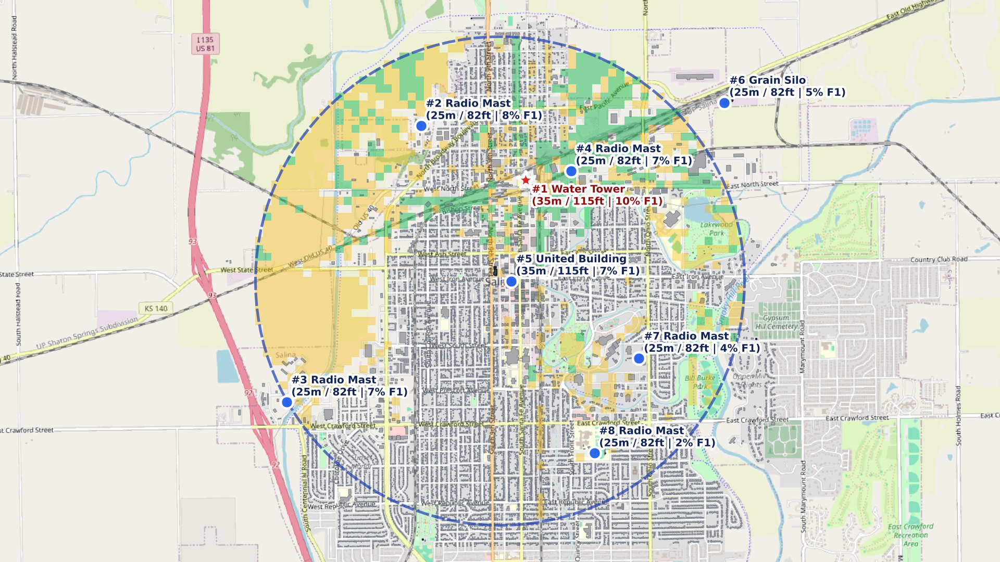

# LoRa-GIS 915 MHz City Viewshed & Rooftop Ranking: Salina (2026-11-23_18-39-45)

## 1. City Study Overview

| Parameter | Value |
| :--- | :--- |
| **Study Center** | **Salina** (`38.840287, -97.611432`, UTM Zone 14N) |
| **Study Radius** | `2.50 km` (`1.55 mi`), `2,933` target points (`~82 m` spacing) |
| **Operating Frequency** | `915.0 MHz` (LoRa / MeshCore, $\lambda = 32.8\text{ cm}$) |
| **Target Fresnel Clearance** | `>= 60%` of 1st Fresnel Zone ($F_1$), $K = 4/3$ Earth Curvature |
| **Rooftop Mast Height** | `3.05 m` (`10.0 ft`) above structure |
| **Target Receiver Height** | `1.83 m` (`6.0 ft`) AGL |
| **Surface Sampling** | DSM nearest-neighbor (`5.0 m` ray step, `12.0 m` rooftop margin) |
| **Candidates Evaluated** | `9` structures (showing top `8`) |
| **Building Overlay** | OpenStreetMap (`12,281` structures, `17` >= 15 m, max `35.0 m` / `115 ft`) |

## 2. Top Ranked Rooftops & Tall Structures (Top 8)

| Rank | Structure | Type / Address | Coordinates (Lat, Lon) | Ground Elev | Height | Mast | >= 60% $F_1$ Coverage | Optical LOS Coverage | Max Clear Range |
| :--- | :--- | :--- | :--- | :--- | :--- | :--- | :--- | :--- | :--- |
| `#1` | **Water Tower** | Water Tower | `38.849531, -97.608212` | `372 m` (`1,221 ft`) | `35.0 m` (`115 ft`) | `10 ft` | **`10.1%`** | `34.4%` | `2.83 km` (`1.76 mi`) |
| `#2` | **Radio Mast** | Mast | `38.854688, -97.620430` | `373 m` (`1,223 ft`) | `25.0 m` (`82 ft`) | `10 ft` | **`7.9%`** | `27.8%` | `3.85 km` (`2.39 mi`) |
| `#3` | **Radio Mast** | Mast | `38.829386, -97.636753` | `374 m` (`1,228 ft`) | `25.0 m` (`82 ft`) | `10 ft` | **`6.9%`** | `21.5%` | `4.27 km` (`2.65 mi`) |
| `#4` | **Radio Mast** | Mast | `38.850304, -97.602842` | `372 m` (`1,221 ft`) | `25.0 m` (`82 ft`) | `10 ft` | **`6.7%`** | `27.2%` | `2.43 km` (`1.51 mi`) |
| `#5` | **United Building** | Building, `119 West Iron Avenue` | `38.840236, -97.610060` | `374 m` (`1,226 ft`) | `35.0 m` (`115 ft`) | `10 ft` | **`6.6%`** | `34.1%` | `2.60 km` (`1.62 mi`) |
| `#6` | **Grain Silo** | Silo | `38.856384, -97.584648` | `372 m` (`1,220 ft`) | `25.0 m` (`82 ft`) | `10 ft` | **`4.6%`** | `18.0%` | `2.42 km` (`1.50 mi`) |
| `#7` | **Radio Mast** | Mast | `38.832927, -97.595168` | `374 m` (`1,226 ft`) | `25.0 m` (`82 ft`) | `10 ft` | **`4.3%`** | `20.9%` | `1.96 km` (`1.22 mi`) |
| `#8` | **Radio Mast** | Mast | `38.824272, -97.600609` | `375 m` (`1,232 ft`) | `25.0 m` (`82 ft`) | `10 ft` | **`2.4%`** | `18.7%` | `1.79 km` (`1.11 mi`) |

## 3. Optimal Multi-Site Combinations (Greedy Set-Cover)

| Sites | Added Structure | Marginal $F_1$ Gain | Cumulative >= 60% $F_1$ | Cumulative Optical LOS |
| :--- | :--- | :--- | :--- | :--- |
| **1-Site** | **Water Tower** (`38.84953, -97.60821`) | `+10.1%` | **`10.1%`** | `34.4%` |
| **2-Site** | **Radio Mast** (`38.82939, -97.63675`) | `+6.7%` | **`16.8%`** | `39.4%` |
| **3-Site** | **Radio Mast** (`38.85469, -97.62043`) | `+5.9%` | **`22.7%`** | `43.3%` |

